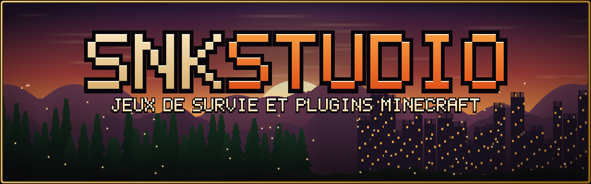

Salut, moi c'est <b>SnkAlex</b>. Je crée des <b>jeux de survie</b> et des <b>plugins Minecraft</b>.

<a href="#jeux"><b>🎮 Jeux</b></a> &nbsp;•&nbsp;
<a href="#plugins"><b>🧩 Plugins Minecraft</b></a> &nbsp;•&nbsp;
<a href="#contact"><b>📩 Contact</b></a>

 

<table>
<tr>
<td width="50%" align="center" valign="top">

<h3><a href="https://github.com/SnkStudio/WildHold">WildHold</a></h3>
Survie low-poly, seul ou entre amis : récolte, construction, villages, grottes, donjons, volcans et monstres la nuit.  
<b>PC (Windows)</b> · alpha  
<a href="https://github.com/SnkStudio/WildHold/releases/latest"><b>⬇️ Télécharger</b></a>
</td>
<td width="50%" align="center" valign="top">

<h3><a href="https://github.com/SnkStudio/TheLastDawn">The Last Dawn</a></h3>
Survie zombie en pixel art : fouille, bâtis ton camp le jour et tiens jusqu'à l'aube. Toutes les 7 nuits, la Nuit rouge.  
<b>PC (Windows) et Android</b> · alpha  
<a href="https://github.com/SnkStudio/TheLastDawn/releases/latest"><b>⬇️ Télécharger</b></a>
</td>
</tr>
</table>

 

Pour serveurs <b>Paper 1.21.4 à 26.3</b>. Menus dessinés, en français, et tous reliés entre eux. Chacun marche seul, sauf SnkBoutiques qui demande SnkClans.

<table>
<tr>
<td width="50%" valign="top">

<h3>🛒 <a href="https://github.com/SnkStudio/SnkMarche">SnkMarche</a></h3>
Boutique de 1 300 objets, vente, promos du jour et hôtel des ventes entre joueurs.
</td>
<td width="50%" valign="top">

<h3>⚔️ <a href="https://github.com/SnkStudio/SnkClans">SnkClans</a></h3>
Clans complets : banque, coffre, territoire, vol, alliances, guerres et missions.
</td>
</tr>
<tr>
<td width="50%" valign="top">

<h3>⛏️ <a href="https://github.com/SnkStudio/SnkMetiers">SnkMetiers</a></h3>
6 métiers, 50 niveaux, des pouvoirs, des missions chaque jour et de l'argent.
</td>
<td width="50%" valign="top">

<h3>💎 <a href="https://github.com/SnkStudio/SnkGemmes">SnkGemmes</a></h3>
21 outils en émeraude, rubis et saphir, avec leurs pouvoirs et leurs textures.
</td>
</tr>
<tr>
<td width="50%" valign="top">

<h3>📦 <a href="https://github.com/SnkStudio/SnkBoutiques">SnkBoutiques</a></h3>
Les joueurs ouvrent leurs boutiques avec de vrais coffres, dans le territoire de leur clan.
</td>
<td width="50%" valign="middle" align="center">
<h3>🎖️ SnkPass</h3>
<b>Bientôt</b> Un pass de saison : missions, 50 paliers, récompenses et cosmétiques.
</td>
</tr>
</table>

 

<h2 align="center">📩 Contact</h2>

Une question, un bug ou envie d'un plugin ? Ouvre la page du projet, puis l'onglet <b>Issues</b>. 
Les messages sont publics : pas d'adresse e-mail, de mot de passe ni d'information de paiement.

